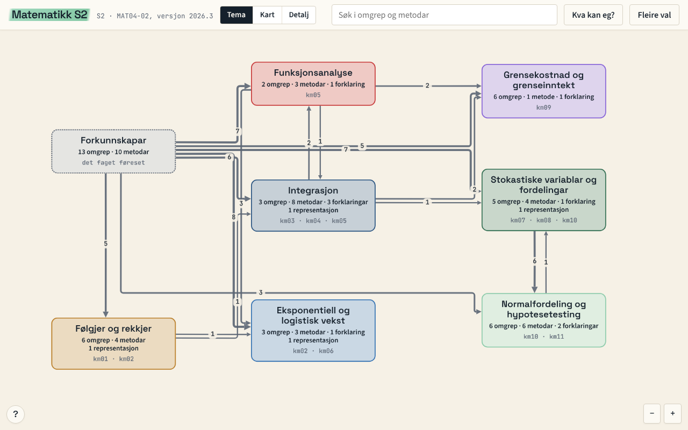

# Fagkart: Matematikk S2

Eit interaktivt fagkart over læreplanen i matematikk S2 (MAT04-02): kompetansemåla, omgrepa, metodane og forklaringane, forkunnskapane faget byggjer på, og korleis alt heng saman. Elevar kan sjå kva dei bør ta att og kva som er neste steg. Lærarar kan bruke kartet til å planleggje.



Kartet er eit utkast. Det er laga med KI-hjelp og kan ha faglege feil. Fann du ein, [opprett eit Issue](https://github.com/lektorodd/fagkart/issues).

## Opne kartet

- **På nett:** <https://fagkart.lektorodd.no/s2/>
- **Elevvising:** <https://fagkart.lektorodd.no/s2/?vising=elev> (utan lærartekst, med «Kva kan eg?» og «Neste steg»)
- **I itslearning:** legg inn elevvisinga som ei vanleg lenkje. Ho opnar i ei ny fane. Kartet kan òg byggjast inn i ei side (iframe), men om eigenvurderinga til elevane blir lagra då, er ikkje prøvd i itslearning.
- **Nedlasta kopi:** `dist/S2.html` er éi fil som verkar utan nett. Last ho ned og opne ho i nettlesaren. Ligg det ei nyare versjon ute, seier kartet frå øvst på sida.

Begynn på **Tema** (oversikta), gå til **Kart** og **Detalj** med knappane eller ved å zoome, og trykk på ein node for å sjå forklaring, døme og vanlege misforståingar.

## Ingen elevdata

Kartet samlar ikkje inn noko. Det som ein elev markerer i «Kva kan eg?», blir liggjande i nettlesaren hennar eller hans (og kan lastast ned som fil). Det blir ikkje send nokon stad. Sida spør berre nettstaden om det finst ei nyare versjon av kartet, og sender ikkje noko om deg. Dette repoet inneheld heller ingen elevdata, og skal aldri ha det.

## Gjenbruk og sitering

- **Innhald** (`kart/` og `dist/*.json`): [CC BY 4.0](LICENSE-innhald). Du kan bruke og endre det, også i undervisning og kommersielt, så sant du oppgir kjelde.
- **Kode** (`scripts/`, `viewer/`, `tests/`): [MIT](LICENSE).
- **Læreplantekst** (`kjelder/`): tekst frå Utdanningsdirektoratet. Læreplanane er fastsette som forskrift og er ikkje verna av opphavsrett (åndsverklova § 14), men oppgi kjelda.

Slik kan du sitere kartet (same opplysningar står i [`CITATION.cff`](CITATION.cff), og GitHub viser dei under «Cite this repository»):

> Ottestad, T. F. (2026). *Fagkart: Matematikk S2* (versjon 2026.3). https://fagkart.lektorodd.no/s2/

## Lag ditt eige kart

Same oppskrift gjeld for andre læreplanar:

1. Lag mappa `kart/<KODE>/` med ein `meta.yaml` (læreplankode, namn, versjon, kjerneelement, kompetansemål).
2. Legg læreplanteksten **ordrett** i `kjelder/<KODE>.md`. Lint sjekkar at kompetansemåla stemmer.
3. Skriv éi klyngjefil per tema, og ei `forkunnskap.yaml`.
4. Køyr `python3 scripts/lint.py`, så `python3 scripts/bygg.py`, så `cd viewer && npm ci && npm run build`.

Heile oppskrifta, med døme, står i [`docs/LAG-EIT-KART.md`](docs/LAG-EIT-KART.md). Dataformatet er skrive ned i [`docs/FORMAT.md`](docs/FORMAT.md).

## Byggje sjølv

Du treng Python 3 og Node.js.

```
pip install -r requirements.txt
python3 scripts/lint.py
python3 scripts/bygg.py
python3 -m unittest discover -s tests
cd viewer && npm ci && npm run build && npm test
```

`npm run build` lagar `dist/S2.html`. Nettlesartestane treng Chromium (set `CHROMIUM_PATH` om han ikkje ligg på standardstaden), elles blir dei hoppa over.

## Innspel og rettingar

Fagfeil, uklare forklaringar og forslag er velkomne som [Issues](https://github.com/lektorodd/fagkart/issues). Les [`CONTRIBUTING.md`](CONTRIBUTING.md) først. Dette repoet er ein eittvegs-kopi: endringar blir gjorde i eit anna repo og kjem hit med neste utgåve (éin commit per utgåve). Pull requests blir lesne, men ikkje fletta direkte.

## Kjelder

- Læreplanane frå [Utdanningsdirektoratet](https://www.udir.no/lk20/): matematikk S (MAT04-02), og for forkunnskapane òg 1P (MAT08-01), 1T (MAT09-02) og 1.–10. trinn (MAT01-06).
- NDLA er brukt som referanse for kva som blir undervist. Innhald derifrå er ikkje kopiert.

## Kven har laga det

Torodd F. Ottestad, med hjelp frå KI (Claude). Arbeidsmåten med agentane står kort i [`docs/LAG-EIT-KART.md`](docs/LAG-EIT-KART.md) og i `.claude/agents/`.
